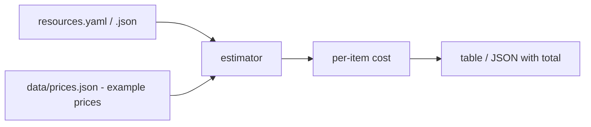

# cloud-cost-estimator

A small Python CLI that estimates **monthly cloud cost** from a YAML or JSON list of resources.

> **Example prices only.** The bundled `data/prices.json` contains made-up, illustrative numbers. It is **not** real pricing and **not** a quote from any cloud provider. Replace it with your own figures for real planning.

## Problem
Before building anything in the cloud, teams want a rough monthly budget. This shows how a resource list turns into a cost breakdown.

## How it works


## Setup
```bash
python3 -m venv .venv && source .venv/bin/activate
pip install -r requirements.txt   # PyYAML is only needed for YAML input
pytest
```

## Usage
```bash
python estimator.py resources.example.yaml
python estimator.py resources.example.yaml --json
python estimator.py my_resources.json --prices my_prices.json
```
Supported resource types: `compute`, `database` (size, count, optional `hours_per_month`), `storage` (tier, gb), `load_balancer` (count), `data_transfer` (gb).

## Sample output
```
Resource                         USD/month
compute medium x3                   109.50
compute small x2                      8.00
storage standard 500GB               10.00
storage archive 2000GB                8.00
database small x1                    21.90
load balancer x1                     18.00
data transfer 300GB                  24.00
------------------------------------------
TOTAL                               199.40
NOTE: uses example prices only. This is not a real quote.
```

## Limitations
- Few resource types, flat pricing: no regions, discounts, tiered transfer pricing, or taxes.
- Does not connect to any cloud account or pricing API.

## What it demonstrates
Cloud cost awareness (FinOps basics), config-driven design, data validation with clear errors, and unit tests for calculations.

## License
MIT
